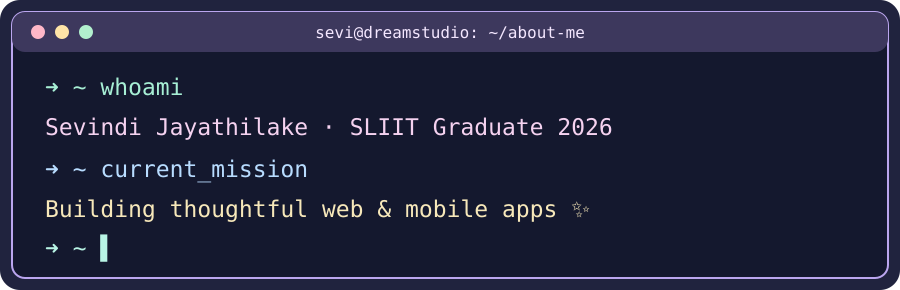
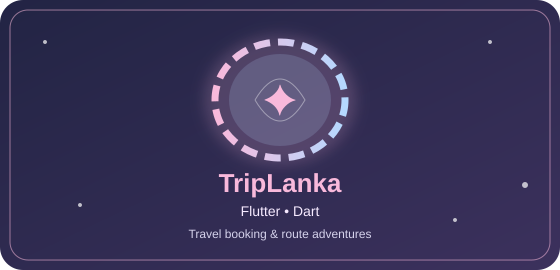
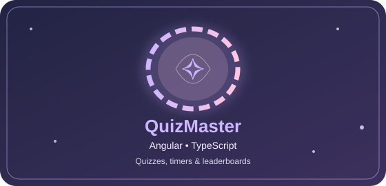
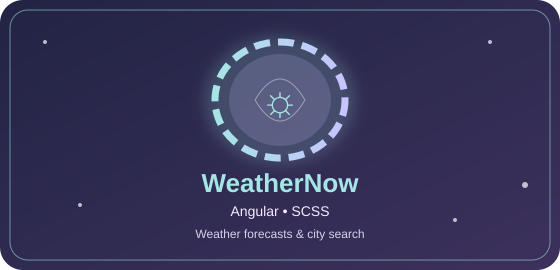
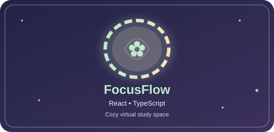
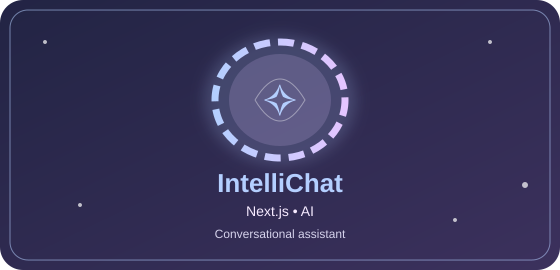
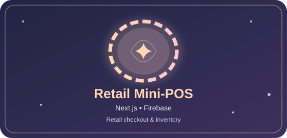

<div align="center">



<a href="https://sevindi-portfolio.vercel.app/"></a>
<a href="https://github.com/sevi2001"></a>
<a href="https://www.linkedin.com/in/sevindi-jayathilake-b840132a3/"></a>

### 🌸 Welcome to my enchanted code garden

*Where imagination meets engineering, and every project is a new little adventure.*



</div>

## 🦋 A little about me

I'm **Sevindi Maleesha Jayathilake**, a **2026 SLIIT Information Technology graduate** and former **Trainee Software Engineer at Hayleys Fentons**. I enjoy building expressive, useful web and mobile applications, experimenting with new frameworks, and continuously learning.

- 🌷 **Currently exploring:** Angular, Next.js, React, and Flutter
- 🧩 **I enjoy:** thoughtful interfaces, animation, and problem solving
- 💼 **Career interests:** Software Engineer / Associate Software Engineer
- ✨ **My approach:** Learn → Build → Improve → Share

## 💫 My technology garden

<div align="center">

**Languages**


**Frontend & mobile**


**Backend, data & tools**


</div>

## 🪄 Magical Project Portals

<div align="center">

*Six little worlds. One developer journey. Choose a portal to explore.*

✨ The stars twinkle, the portal rings rotate, and each world glows. ✨

</div>

### 01 · TripLanka

<div align="center">



[📂 Source code](https://github.com/sevi2001/triplanka) &nbsp; · &nbsp; [🌷 Live demo](https://triplanka.vercel.app/)

</div>

### 02 · QuizMaster

<div align="center">



[📂 Source code](https://github.com/sevi2001/quiz-master) &nbsp; · &nbsp; [🌷 Live demo](https://quiz-master-nu-gules.vercel.app/)

</div>

### 03 · WeatherNow

<div align="center">



[📂 Source code](https://github.com/sevi2001/weather-now) &nbsp; · &nbsp; [🌷 Live demo](https://weather-now-nine-azure.vercel.app/)

</div>

### 04 · FocusFlow

<div align="center">



[🌷 Live demo](https://focusflow-delta-liard.vercel.app/)

</div>

### 05 · IntelliChat

<div align="center">



[🌷 Explore portfolio](https://sevindi-portfolio.vercel.app/)

</div>

### 06 · Retail Mini-POS

<div align="center">



[🌷 Explore portfolio](https://sevindi-portfolio.vercel.app/)

</div>

<details>
<summary><b>🏛️ Secret portal · Smart Museum Guide (SLIIT research)</b></summary>

A Flutter and FastAPI museum guide with QR-linked artifact information, multilingual content, personalized recommendations, and visitor interaction tracking. My contribution focused on the QR-based personalized guide.

</details>

## 🌱 My developer journey

```text
2024 ── 🌱 Started developing professional software at Hayleys Fentons
2025 ── 🌷 Built and refined university and internship projects
2026 ── 🎓 Graduated from SLIIT
     └─ ✨ Continued creating Flutter, Angular, React & Next.js projects
```

## 🤖 Meet SeviBot

<div align="center">


</div>

A friendly little assistant on my portfolio that helps visitors discover my projects, skills, experience, and CV.

<div align="center">

[🌸 Visit SeviBot in my portfolio](https://sevindi-portfolio.vercel.app/)

### 💌 Let's create something wonderful

[Portfolio](https://sevindi-portfolio.vercel.app/) · [LinkedIn](https://www.linkedin.com/in/sevindi-jayathilake-b840132a3/) · [Email](mailto:sevindijayathilake2001@gmail.com)


</div>
