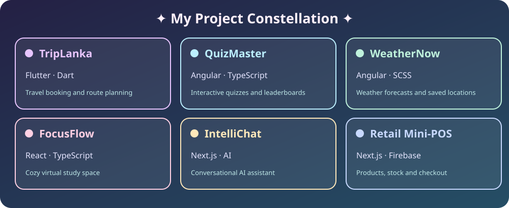

<div align="center">


<a href="https://sevindi-portfolio.vercel.app/"></a>
<a href="https://github.com/sevi2001"></a>
<a href="https://www.linkedin.com/in/sevindi-jayathilake-b840132a3/"></a>

### 🌸 Welcome to my enchanted code garden

*Where imagination meets engineering, and every project is a new little adventure.*


</div>

## 🦋 A little about me

I'm **Sevindi Maleesha Jayathilake**, a **2026 SLIIT Information Technology graduate** and former **Trainee Software Engineer at Hayleys Fentons**. I enjoy building expressive, useful web and mobile applications, experimenting with new frameworks, and continuously learning.

- 🌷 **Currently exploring:** Angular, Next.js, React, and Flutter
- 🧩 **I enjoy:** thoughtful interfaces, animation, and problem solving
- 💼 **Career interests:** Software Engineer / Associate Software Engineer
- ✨ **My approach:** Learn → Build → Improve → Share

## 💫 My technology garden

<div align="center">

**Languages**


**Frontend & mobile**


**Backend, data & tools**


</div>

## 🌌 Portals to my projects

<div align="center"></div>

| ✨ Project | 🌷 What I built | 🔗 Explore |
|:--|:--|:--|
| **TripLanka** | Flutter travel booking and route planning | [GitHub](https://github.com/sevi2001/triplanka) · [Live](https://triplanka.vercel.app/) |
| **QuizMaster** | Angular quiz platform with timers and leaderboards | [GitHub](https://github.com/sevi2001/quiz-master) · [Live](https://quiz-master-nu-gules.vercel.app/) |
| **WeatherNow** | Angular weather dashboard | [GitHub](https://github.com/sevi2001/weather-now) · [Live](https://weather-now-nine-azure.vercel.app/) |
| **FocusFlow** | Cozy React study space | [Live](https://focusflow-delta-liard.vercel.app/) |
| **IntelliChat** | Next.js conversational assistant | [Portfolio](https://sevindi-portfolio.vercel.app/) |
| **Retail Mini-POS** | Firebase-powered retail management | [Portfolio](https://sevindi-portfolio.vercel.app/) |

<details>
<summary><b>🌼 Open my university research garden</b></summary>

### Smart Museum Guide — SLIIT Research Project

A Flutter and FastAPI museum guide with QR-linked artifact information, multilingual content, personalized recommendations, and visitor interaction tracking. My contribution focused on the QR-based personalized guide.

</details>

## 🌱 My developer journey

```text
2024 ── 🌱 Started developing professional software at Hayleys Fentons
2025 ── 🌷 Built and refined university and internship projects
2026 ── 🎓 Graduated from SLIIT
     └─ ✨ Continued creating Flutter, Angular, React & Next.js projects
```


## 🤖🌸 Meet SeviBot — My Little Coding Companion

<div align="center">


### 💗 Hello, I'm SeviBot!

Your little guide through Sevindi's coding universe!

✨ Explore my projects  
🌷 Discover my technical skills  
💻 Learn about my development journey  
💌 Find my portfolio and contact details  

<a href="https://sevindi-portfolio.vercel.app/">
  
</a>

</div>

### 💌 Let's create something wonderful

[Portfolio](https://sevindi-portfolio.vercel.app/) · [LinkedIn](https://www.linkedin.com/in/sevindi-jayathilake-b840132a3/) · [Email](mailto:sevindijayathilake2001@gmail.com)


</div>
