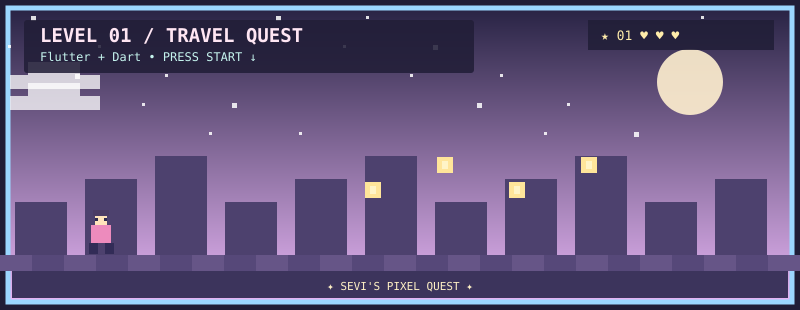
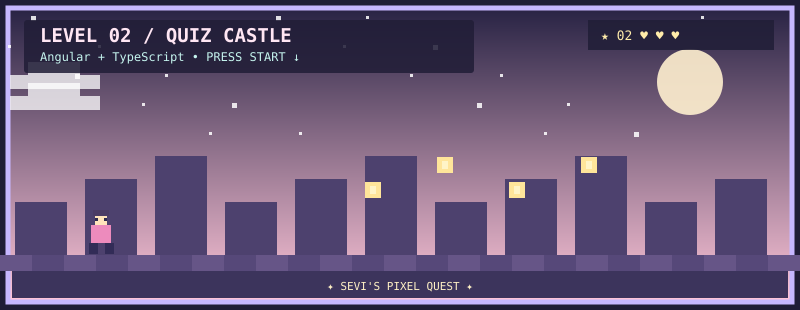
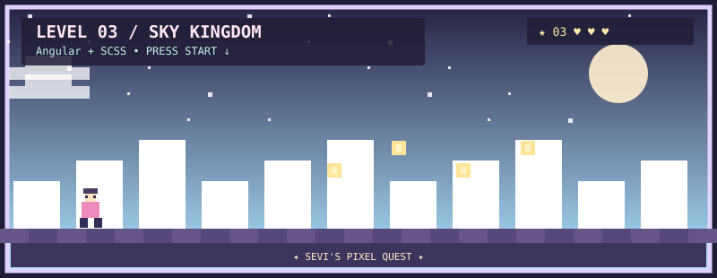
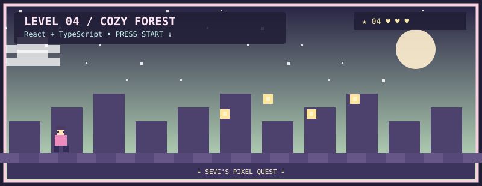
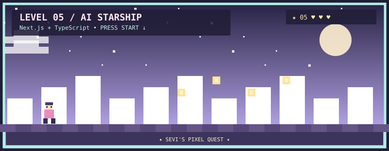
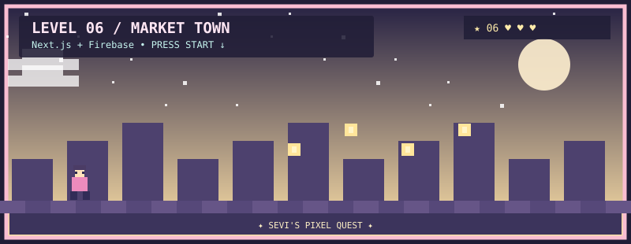

### 🌸 Welcome to my enchanted code garden

*Where imagination meets engineering, and every project is a new little adventure.*

## 🦋 A little about me

I'm **Sevindi Maleesha Jayathilake**, a **2026 SLIIT Information Technology graduate** and former **Trainee Software Engineer at Hayleys Fentons**. I enjoy building expressive, useful web and mobile applications, experimenting with new frameworks, and continuously learning.

- 🌷 **Currently exploring:** Angular, Next.js, React, and Flutter
- 🧩 **I enjoy:** thoughtful interfaces, animation, and problem solving
- 💼 **Career interests:** Software Engineer / Associate Software Engineer
- ✨ **My approach:** Learn → Build → Improve → Share

## 💫 My technology garden

**Languages**

**Frontend & mobile**

**Backend, data & tools**

## 🎮 Project Arcade · Sevi’s Pixel Quest

**Welcome, player!** 🌸 Choose a level and explore what I’ve built.

*Animated pixel worlds · jumping character · floating coins · moving clouds · twinkling stars*

### 🕹️ LEVEL 01 — TripLanka

**TRAVEL QUEST** · `Flutter + Dart`

Explore routes, rides and trip planning.

[💻 Source Code](https://github.com/sevi2001/triplanka) &nbsp; • &nbsp; [✨ Play / Live Demo](https://triplanka.vercel.app/)

---

### 🕹️ LEVEL 02 — QuizMaster

**QUIZ CASTLE** · `Angular + TypeScript`

Beat the clock and climb the leaderboard.

[💻 Source Code](https://github.com/sevi2001/quiz-master) &nbsp; • &nbsp; [✨ Play / Live Demo](https://quiz-master-nu-gules.vercel.app/)

---

### 🕹️ LEVEL 03 — WeatherNow

**SKY KINGDOM** · `Angular + SCSS`

Forecasts, favorites and weather search.

[💻 Source Code](https://github.com/sevi2001/weather-now) &nbsp; • &nbsp; [✨ Play / Live Demo](https://weather-now-nine-azure.vercel.app/)

---

### 🕹️ LEVEL 04 — FocusFlow

**COZY FOREST** · `React + TypeScript`

Focus timers, tasks and a cozy study world.

[✨ Play / Live Demo](https://focusflow-delta-liard.vercel.app/)

---

### 🕹️ LEVEL 05 — IntelliChat

**AI STARSHIP** · `Next.js + TypeScript`

Chat assistant with conversation history.

[🌸 Explore my portfolio](https://sevindi-portfolio.vercel.app/)

---

### 🕹️ LEVEL 06 — Retail Mini-POS

**MARKET TOWN** · `Next.js + Firebase`

Inventory, checkout and sales management.

[🌸 Explore my portfolio](https://sevindi-portfolio.vercel.app/)

---

<b>🔓 BONUS LEVEL — Smart Museum Guide (SLIIT Research)</b>

**Flutter · FastAPI** — AI-assisted museum guide with QR-linked artifact information, multilingual content, personalized recommendations and visitor-interaction tracking. My contribution focused on the QR-based personalized guide.

## 🤖 Meet SeviBot

A friendly little assistant on my portfolio that helps visitors discover my projects, skills, experience, and CV.

[🌸 Visit SeviBot in my portfolio](https://sevindi-portfolio.vercel.app/)

### 💌 Let's create something wonderful

[Portfolio](https://sevindi-portfolio.vercel.app/) · [LinkedIn](https://www.linkedin.com/in/sevindi-jayathilake-b840132a3/) · [Email](mailto:sevindijayathilake2001@gmail.com)

