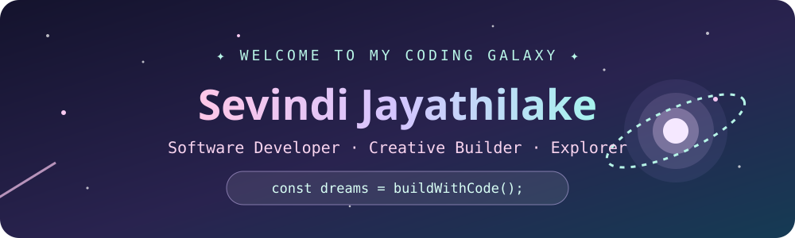
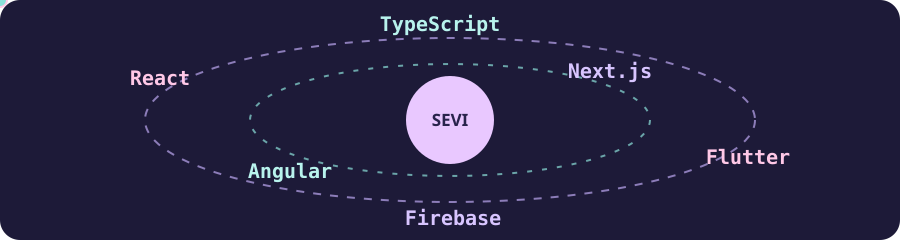

<div align="center">



<br/>


[](https://sevindi-portfolio.vercel.app/)
[](https://www.linkedin.com/in/sevindi-jayathilake-b840132a3/)
[](mailto:sevindijayathilake2001@gmail.com)

</div>

---

### 🌷 `01 / hello_world` — A little about me

```typescript
const sevindi = {
  education: "BSc (Hons) in Information Technology — SLIIT, 2026",
  experience: "Trainee Software Engineer — Hayleys Fentons (2024–2025)",
  interests: ["Full-stack web", "Mobile apps", "Creative UI", "AI"],
  currently: "Building projects and exploring software engineering opportunities",
  motto: "Keep learning. Keep creating. ✨"
};
```

I love turning ideas into useful, polished digital experiences. My work spans responsive websites, mobile apps, management systems, and playful interactive interfaces.

### 🪐 `02 / tech_universe` — My technology orbit

<div align="center">


**Languages** · JavaScript · TypeScript · Java · Python · Kotlin · Dart · SQL  
**Frontend** · React · Angular · Next.js · HTML · CSS · Tailwind · Bootstrap  
**Backend & Data** · FastAPI · Node.js · Firebase · Supabase · MongoDB · MySQL  
**Mobile & Tools** · Flutter · Android Studio · Git · GitHub · Postman · Vercel
</div>

### 🧩 `03 / project_portals` — Choose a world to explore

| 🌸 Project | ✨ What I built | 🔗 Explore |
|:--|:--|:--|
| **TripLanka** · Flutter | Travel booking, planned trips, routes, driver tools and cost splitting | [Code](https://github.com/sevi2001/triplanka) · [Live](https://triplanka.vercel.app/) |
| **QuizMaster** · Angular | Animated quizzes, countdown timers, difficulty levels and leaderboard | [Code](https://github.com/sevi2001/quiz-master) · [Live](https://quiz-master-nu-gules.vercel.app/) |
| **WeatherNow** · Angular | Weather forecasts, favorites and temperature conversion | [Code](https://github.com/sevi2001/weather-now) · [Live](https://weather-now-nine-azure.vercel.app/) |
| **FocusFlow** · React | Cozy virtual study room, Pomodoro, planner and ambient sounds | [Live](https://focusflow-delta-liard.vercel.app/) |
| **Smart Museum Guide** · Flutter + FastAPI | QR-based personalized artifact guide and multilingual information | Research project |
| **IntelliChat** · Next.js | Conversational AI assistant with saved conversations | Personal project |

<details>
<summary><b>💌 Open my little project diary</b></summary>
<br/>

- 🧳 **TripLanka:** Practised building a travel-focused mobile interface and map-based workflows.
- 🧠 **QuizMaster:** Learned Angular by building a complete interactive quiz experience.
- ☁️ **WeatherNow:** Explored external API integration and responsive dashboards.
- 🕯️ **FocusFlow:** Combined productivity features with cozy, animated design.

</details>

### 🌠 `04 / my_journey` — A constellation of milestones

```text
2024  ✦  Trainee Software Engineer @ Hayleys Fentons
  │
2025  ✦  Building research and software projects
  │
2026  ✦  Graduated from SLIIT
  │
NOW   ✦  Exploring Flutter, Angular, React and Next.js
  │
NEXT  ✦  Contributing to an amazing engineering team 🚀
```

### 🤖 `05 / sevibot_corner` — A friendly guide

<div align="center">

**Meet SeviBot — my little portfolio assistant!** 🌷

Explore my projects, background, and skills through my [interactive portfolio](https://sevindi-portfolio.vercel.app/).

[](https://sevindi-portfolio.vercel.app/)

</div>

### 💌 `06 / send_a_signal` — Let's connect

<div align="center">

**Have a project idea, opportunity, or just want to say hello?**

[Portfolio](https://sevindi-portfolio.vercel.app/) · [LinkedIn](https://www.linkedin.com/in/sevindi-jayathilake-b840132a3/) · [Email](mailto:sevindijayathilake2001@gmail.com)

*Made with curiosity, creativity and a little stardust.* ✨

</div>
