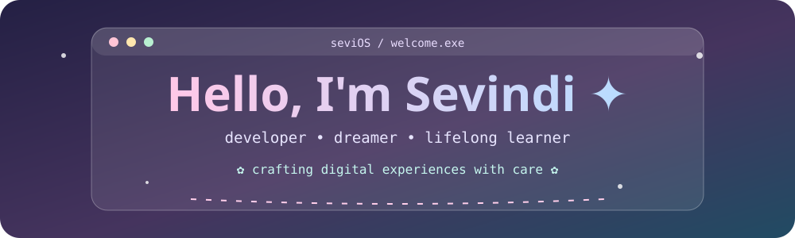
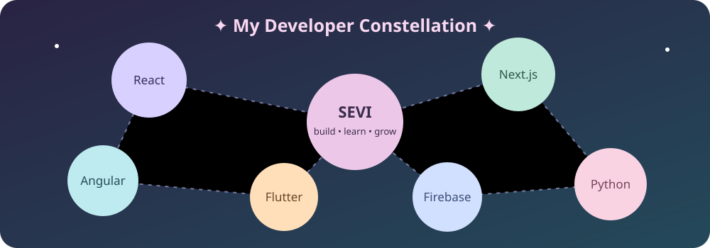

<div align="center">



### ✦ Welcome to SeviOS ✦


[](https://sevindi-portfolio.vercel.app/)
[](https://www.linkedin.com/in/sevindi-jayathilake-b840132a3/)
[](mailto:sevindijayathilake2001@gmail.com)

</div>

---

## 🪟 01 / The developer behind the screen

```typescript
const sevindi = {
  name: "Sevindi Maleesha Jayathilake",
  location: "Sri Lanka 🇱🇰",
  education: "BSc (Hons) Information Technology · SLIIT · 2026",
  experience: "Trainee Software Engineer · Hayleys Fentons",
  currently: "Building, learning & exploring new ideas",
  interests: ["Web Development", "Mobile Apps", "AI", "UI/UX"],
  openTo: ["Software Engineer", "Associate Software Engineer"],
  motto: "Create with curiosity. Grow with every commit. ✨"
};
```

> 🌷 I’m a recent IT graduate and former Trainee Software Engineer who loves turning ideas into thoughtful digital experiences. I build web and mobile applications, experiment with new frameworks, and enjoy creating interfaces that feel as good as they work.

## 🪄 02 / My creative toolkit

<div align="center">

| 🎨 Frontend studio | 📱 Mobile universe | ⚙️ Backend & data |
|:---:|:---:|:---:|
| React · Angular · Next.js | Flutter · Dart · Kotlin | FastAPI · REST APIs |
| TypeScript · JavaScript | Android Studio | Firebase · Supabase |
| HTML · CSS · Tailwind | Mobile UI | MongoDB · MySQL |

<br/>


</div>

## 🧸 03 / Project windows

<table>
<tr>
<td width="50%" valign="top">
<h3>🚕 TripLanka</h3>
<p><b>Flutter · Dart</b></p>
<p>A travel booking experience with trip planning, multiple stops, route previews, driver features and cost splitting.</p>
<a href="https://github.com/sevi2001/triplanka">⌁ Source code</a> · <a href="https://triplanka.vercel.app/">✦ Live demo</a>
</td>
<td width="50%" valign="top">
<h3>🧠 QuizMaster</h3>
<p><b>Angular · TypeScript</b></p>
<p>An interactive quiz world with categories, difficulty levels, timers, scoring and a leaderboard.</p>
<a href="https://github.com/sevi2001/quiz-master">⌁ Source code</a> · <a href="https://quiz-master-nu-gules.vercel.app/">✦ Live demo</a>
</td>
</tr>
<tr>
<td valign="top">
<h3>🌦️ WeatherNow</h3>
<p><b>Angular · SCSS</b></p>
<p>Weather forecasts, saved locations, hourly conditions and a polished dashboard.</p>
<a href="https://github.com/sevi2001/weather-now">⌁ Source code</a> · <a href="https://weather-now-nine-azure.vercel.app/">✦ Live demo</a>
</td>
<td valign="top">
<h3>☕ FocusFlow</h3>
<p><b>React · TypeScript</b></p>
<p>A cozy virtual study space with a Pomodoro timer, tasks, ambient sound and a companion.</p>
<a href="https://focusflow-delta-liard.vercel.app/">✦ Live demo</a>
</td>
</tr>
</table>

<details>
<summary><b>🌌 Open the project archive</b></summary>
<br/>

- **Smart Museum Guide** — SLIIT research project; Flutter and FastAPI; QR-based personalized museum information.
- **IntelliChat** — AI assistant built with Next.js.
- **Retail Mini-POS** — Product, stock, checkout and sales management application.
- **JobTrack Pro** — Job application tracking dashboard.
- **Developer Portfolio** — My personal portfolio with SeviBot.
- **RouteSphere** — *Planned concept:* logistics and fleet management platform.

</details>

## 🌸 04 / A little coding timeline

```text
2024  🌱  Trainee Software Engineer · Hayleys Fentons
  │
2025  🛠️  Web projects, mobile apps & research
  │
2026  🎓  Graduated from SLIIT
  │
 NOW  ✨  Building Flutter, Angular, React & Next.js projects
  │
 NEXT  🚀  Software Engineer / Associate Software Engineer
```

## ✨ 05 / The constellation dashboard

<div align="center">


**✧ No broken statistics. Just a little map of the technologies I love exploring. ✧**

</div>

## 🤖 06 / Meet SeviBot

<div align="center">


**A tiny assistant living inside my portfolio!**

SeviBot helps visitors explore my projects, skills, experience and contact details.

[**💌 Say hello to SeviBot**](https://sevindi-portfolio.vercel.app/)

</div>

## 💌 07 / Leave a little hello

<div align="center">

*I believe beautiful software begins with curiosity, care, and a little imagination.*

[🌷 Portfolio](https://sevindi-portfolio.vercel.app/) · [💼 LinkedIn](https://www.linkedin.com/in/sevindi-jayathilake-b840132a3/) · [💌 Email](mailto:sevindijayathilake2001@gmail.com)


</div>
